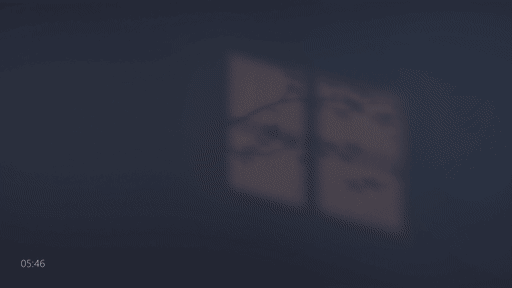
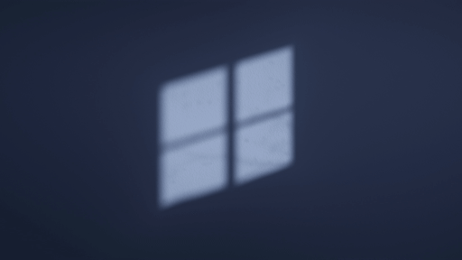
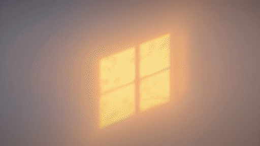
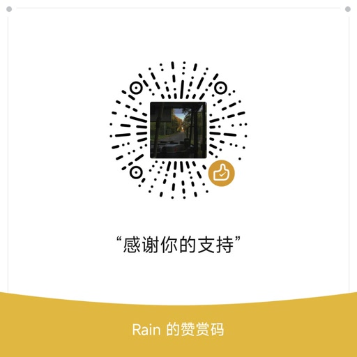

# Slant

English | [简体中文](README.zh-CN.md)

A native Windows 10 / 11 real-time circadian window light wallpaper & lock screen app powered by WebView2 and custom WebGL optics shaders.

[](assets/demo.mp4)

[Watch Demo Video (720p 60fps)](assets/demo.mp4)

## Visual Previews

| Sunrise & Circadian Light | Thunderstorm & Rain |
| :---: | :---: |
|  |  |
| **Winter Snow & Frost** | **Dusk Window Frames** |
|  |  |

## Features

- **Circadian Sunlight & Moonlight**: Simulates natural solar/lunar movement and color temperature across interior walls in real time or accelerated time-lapse — including a three-stage sunrise (cool pre-dawn blush → warm apricot morning → honey-gold), afternoon light, deep amber dusk, and nocturnal moonlight.
- **Live Weather & Unsteady Breathing Wind**: Integrates Open-Meteo real-time weather, precipitation intensity, and wind gusts (clear, rain, thunderstorm with lightning, soft bokeh snow, and window frost). Multi-timescale gust envelopes drive foliage sway, slanted rain streaks, sliding glass droplets, and drifting snow.
- **4 Seasons × 10 Architectural Window Frames**: Switch between Spring Sakura, Summer Foliage, Autumn Maple, and Winter Bare Twigs paired with 10 procedural 3D window optics styles (Cross Window by default, Venetian Blinds, Chinese Lattice, Japanese Shoji, French Arch, Gothic Arch, Moorish Arch, Venetian Serlian, Grid, and Open Window).
- **Native Desktop Embedding & WinRT Lock Screen**: Embeds the live WebGL scene cleanly behind desktop icons (Windows 10 & Windows 11 23H2/24H2/25H2+), captures native physical-resolution static wallpapers, and applies/auto-syncs the Windows lock screen without administrator privileges.
- **Power & GPU Friendly**: Automatically suspends rendering during fullscreen apps/games or when the control panel is minimized/hidden to the system tray.
- **Wallpaper Engine & Lively Support**: Includes `project.json` and `LivelyInfo.json` for direct import into Wallpaper Engine or Lively Wallpaper.

## Requirements & Building from Source

- **Runtime**: Windows 10 (`19041+`) / Windows 11, .NET 8 Desktop Runtime (`x64`), Microsoft Edge WebView2 Runtime
- **Build**: Requires .NET 8 SDK. Run [`Build-EXE.bat`](Build-EXE.bat) from the repository root, or publish manually:

```powershell
dotnet publish src\Slant.csproj -c Release -r win-x64 --self-contained false -p:PublishSingleFile=true -p:IncludeNativeLibrariesForSelfExtract=true -o publish_out
```

- **CLI Flags**:
  - `--window`: Launch in standalone preview window mode without mounting the desktop wallpaper
  - `--desktop` / `--minimized` / `--autostart`: Start silently in the system tray and restore live desktop wallpaper

## Privacy

Network requests are made only after you grant location access or select a city manually (to resolve approximate geolocation and fetch public timezone and forecast data from Open-Meteo). By default, Slant follows your local system clock completely offline. No telemetry, analytics, or account data is ever collected or uploaded; all preferences stay local.

## Feedback & Ongoing Development

Slant is actively maintained and continuously evolving. Bug reports, feature suggestions, and new window frame ideas are always welcome via **Issues** — see [CONTRIBUTING.md](CONTRIBUTING.md) for guidelines (external Pull Requests are not accepted at this time).

## Support

Slant is completely free and open-source. If it brings a bit of calm light to your desktop, buying me a coffee is always appreciated (completely optional):

- ☕ [Support on Ko-fi (PayPal)](https://ko-fi.com/sundaysunset)
- 💚 WeChat Reward:

<p align="left">
  
</p>

## License

Licensed under the [GNU General Public License v3.0 (GPL-3.0)](LICENSE).
