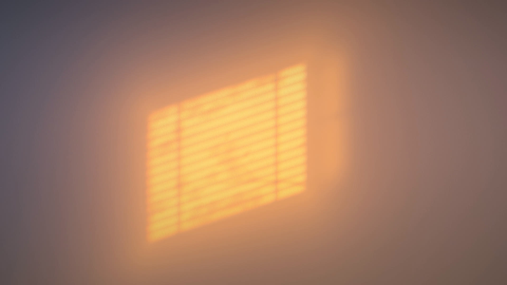
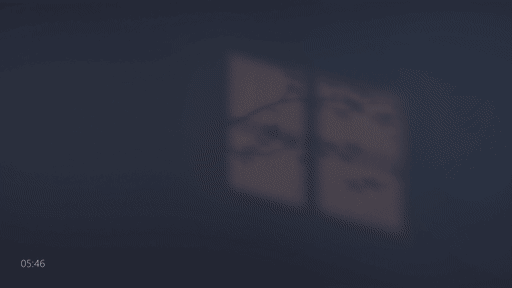
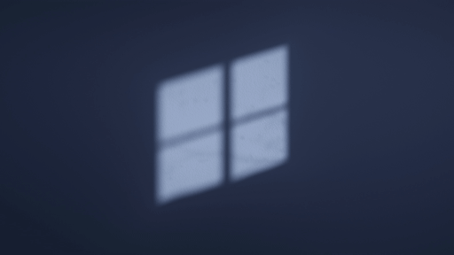
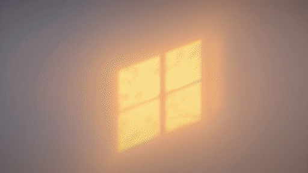
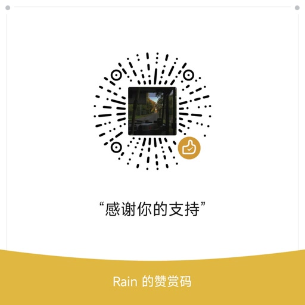

# 寸度 · Slant

[English](README.md) | 简体中文

Windows 10 / 11 原生实时光影动态壁纸与系统锁屏应用（基于 WebView2 + 自定义 WebGL 光学着色器）。

[](assets/demo.mp4)

[观看演示视频（720p 60fps）](assets/demo.mp4)

## 效果预览

| 三段式日出与昼夜光影 | 夏夜雷雨与水痕 |
| :---: | :---: |
|  |  |
| **冬夜飘雪与窗霜** | **黄昏多款窗框切换** |
|  |  |

## 核心特性

- **全天候光影节律**：按本机实时时间或加速周期模拟窗影移动与色温演变，包含三段式自然日出（破晓冷墙微晕 → 朝阳入室 → 暖金晨光）、午后、黄昏余晖与深夜月影。
- **实况天气与非匀速呼吸风**：接入 Open-Meteo 实时天气、降水量强度与阵风数据，支持晴、雨、雷暴（含闪电）、飘雪与窗角薄霜；多尺度阵风包络实时驱动树影摇曳、雨丝倾角、玻璃水滴滑落与飘雪轨迹。
- **四季景物 × 10 款窗框**：支持春樱、夏叶、秋枫、冬枝切换，内置极简十字窗（默认）、百叶窗、中式花窗、日式障子、法式拱窗、哥特尖拱、摩洛哥拱窗、威尼斯三联拱、田字窗、无窗格共 10 种窗影光学模型。
- **原生桌面壁纸与 WinRT 锁屏**：支持将实时 WebGL 画面嵌入桌面图标底层或输出物理分辨率静态壁纸，无需管理员权限即可设置系统锁屏，并支持定时与解锁后自动同步。
- **轻量节电**：检测到全屏游戏或全屏视频时自动暂停动态渲染；控制面板最小化或隐藏至托盘后自动挂起。
- **多工具兼容**：内置 `project.json` 与 `LivelyInfo.json`，可直接导入 Wallpaper Engine 或 Lively Wallpaper。

## 运行要求与从源码编译

- **运行环境**：Windows 10 (`19041+`) / Windows 11，.NET 8 Desktop Runtime (`x64`)，Microsoft Edge WebView2 Runtime
- **编译方式**：安装 .NET 8 SDK 后，直接运行根目录的 [Build-EXE.bat](Build-EXE.bat)，或执行：

```powershell
dotnet publish src\Slant.csproj -c Release -r win-x64 --self-contained false -p:PublishSingleFile=true -p:IncludeNativeLibrariesForSelfExtract=true -o publish_out
```

- **命令行参数**：
  - `--window`：以独立预览窗口模式打开（不自动挂载桌面壁纸）
  - `--desktop` / `--minimized` / `--autostart`：静默启动至系统托盘并按配置恢复动态壁纸

## 隐私说明

默认情况下完全离线运行，仅依据本机系统时钟渲染光影；仅在您主动授予定位或手动选择城市后，才请求定位与 Open-Meteo 接口以同步当地时区和实时天气。程序不包含任何遥测、统计上报或账号上传逻辑，所有偏好设置均保存在本机。

## 持续开发与问题反馈

本项目仍在持续开发与优化中，欢迎通过 **Issues** 反馈 Bug、提出改进建议或分享你希望加入的新窗框样式（暂不接受外部 Pull Request，详见 [CONTRIBUTING.md](CONTRIBUTING.md)）。

## 赞赏支持

寸度完全免费开源；如果它给你的桌面带来了一点安静的陪伴，欢迎请作者喝杯咖啡（完全自愿）：

- ☕ [Ko-fi (PayPal)](https://ko-fi.com/sundaysunset)
- 💚 微信赞赏码：

<p align="left">
  
</p>

## 开源协议

本项目基于 [GNU General Public License v3.0 (GPL-3.0)](LICENSE) 开源。
